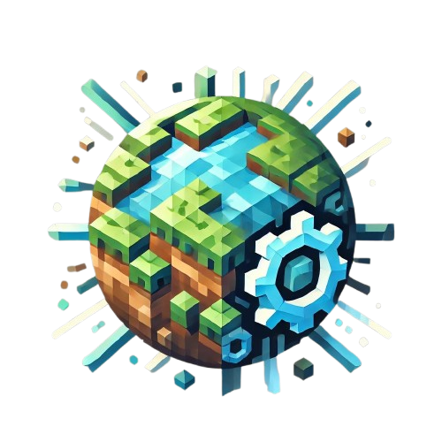

<br />
<div align="center">
  <a href="https://discord.com/users/216487432667791360">
    
</a>

<h3 align="center">WorldEngine</h3>

  <p align="center">
    WorldManagement kept ahead of the curve, always planning a step further.
    <br />
    <br />
    <a href="https://liamxsage.com">Website</a>
    ·
    <a href="https://discord.com/users/216487432667791360"><strong>Contact</strong></a>
  </p>
</div>

## Compatibility

- Paper 26.3 (compiled against `26.3.build.42-alpha`)
- Java 25
- KPaper lifecycle with all optional KPaper features disabled

### Build and validate

With JDK 25 selected, run the checked-in Gradle wrapper:

```sh
bash gradlew clean build --refresh-dependencies --no-daemon
```

The build compiles against Paper 26.3 and runs the unit tests. The plugin JAR is written to `build/libs/`. Pull requests run this same clean build without publishing a release. Jenkins uses its `jdk25` tool and exposes the successful JAR as a downloadable artifact.

KPaperGradle is pinned to the last version that resolves both build and runtime libraries through Maven Central, ModLabs' hosted repository, and CodeMC rather than depending on the broad ModLabs mirror. The KPaper library version remains `2026.9.23.1637`. Malformed mirror responses caused the failed release build; do not restore the mirror-only plugin until its repository routing is fixed.

Before releasing, smoke-test the JAR on an isolated Paper 26.3 server: start with an existing managed dimension, import a new 26.3 Misode share, restart, and verify world loading, teleportation, and generators. Unit tests do not replace this server check.

## PlotSquared compatibility

Use PlotSquared's normal `/plot setup` workflow and keep `PlotSquared` selected as the generator. PlotSquared creates the Bukkit world; WorldEngine discovers the loaded world automatically and manages it through `/world <name>` and the WorldEngine API.

WorldEngine intentionally does not register itself as a `/plot setup` generator.

## Custom dimensions

Stage a void dimension from a Minecraft 26.3 Misode Dimension Type share link:

```text
/worldengine dimension create <world> <share-link>
```

Restart the server once. WorldEngine registers the generated datapack during bootstrap and manages the loaded `worldengine:<world>` dimension afterward. Only HTTPS links from `misode.github.io/dimension-type/` are accepted.

Managed dimension datapacks use Minecraft 26.3 data pack format 121.0. Existing WorldEngine 26.2 packs are upgraded on bootstrap: pack metadata is refreshed and the bed-rule `explodes` field is migrated to `destroy_on_use`. New imports must use a 26.3 Misode share. Back up your worlds and `plugins/WorldEngine/dimension-datapack` before upgrading.

For Geyser compatibility, imported dimension types with a negative `min_y` are mapped to Bedrock's Overworld height model. Existing WorldEngine dimension types are migrated automatically during the next server bootstrap and loaded during that same start.

## API usage

WorldEngine exposes a small Bukkit service API for other plugins:

- Service interface: `cc.modlabs.worldengine.api.WorldEngineApi`
- Convenience accessor: `cc.modlabs.worldengine.WorldEngine.api`

### Kotlin example

```kotlin
import cc.modlabs.worldengine.WorldEngine

val worldEngine = Bukkit.getPluginManager().getPlugin("WorldEngine") as? WorldEngine
    ?: return
val api = worldEngine.api

// Load or create world (same behavior as /world <name>)
val world = api.getOrLoadWorld("event_world") ?: return

// Teleport player to world spawn
api.teleportToWorldSpawn(player, world)

// Create world with a preset generator
val flatGenerator = api.resolveChunkGenerator("flat")
api.createWorld("flat_event", flatGenerator)

// Custom flat base height
val lowFlatGenerator = api.resolveChunkGenerator("flat:64")
api.createWorld("low_flat_event", lowFlatGenerator)

// Copy world asynchronously-ish on main thread callback
api.scheduleWorldCopy(world, "event_world_backup") { result ->
    result.onSuccess { copied ->
        player.sendMessage("Copied world: ${copied.name}")
    }.onFailure { error ->
        player.sendMessage("Copy failed: ${error.message}")
    }
}
```

### Java example

```java
import cc.modlabs.worldengine.api.WorldEngineApi;
import org.bukkit.Bukkit;
import org.bukkit.plugin.RegisteredServiceProvider;

RegisteredServiceProvider<WorldEngineApi> registration =
        Bukkit.getServicesManager().getRegistration(WorldEngineApi.class);
if (registration == null) {
    return;
}

WorldEngineApi api = registration.getProvider();
var world = api.getOrLoadWorld("event_world");
if (world != null) {
    api.teleportToWorldSpawn(player, world);
}
```

### Notes

- API methods are designed to mirror existing command/startup features.
- Permission enforcement is not automatic for API callers; handle authorization in your plugin.
- Built-in generator ids are `empty`, `flat`, and `ocean`. `flat` defaults to base height 128; use `flat:<height>` to override it.

## Dependency (for plugin developers)

WorldEngine is published to ModLabs Nexus.

### Gradle Kotlin DSL (`build.gradle.kts`)

```kotlin
repositories {
    maven("https://repo-api.modlabs.cc/repo/maven/maven-public/")
}

dependencies {
    compileOnly("cc.modlabs.worldengine:WorldEngine:<version>")
}
```
